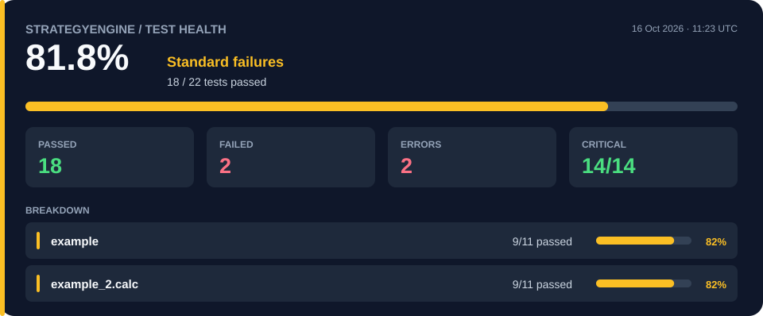

## Testing Dashboard

<!-- TESTING_DASHBOARD_START -->

🔎 **Dive into the detailed test reports**

[example →](reports/example.md) · [example_2.calc →](reports/example_2.calc.md)

Generated automatically from the latest test run.

<!-- TESTING_DASHBOARD_END -->
