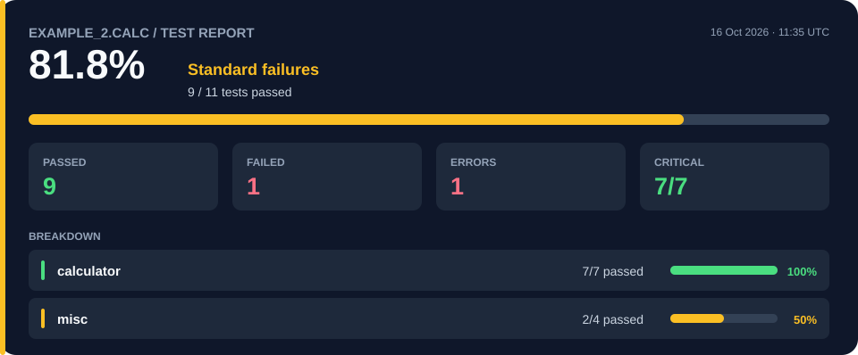

# example_2.calc · Test Report

[← Testing dashboard](../README.md#testing-dashboard)




---

## ✅ Calculator

**7/7 passed** · 100.0%

| Test | Priority | Result | Time |
|:---|:---:|:---:|---:|
| `add` | Critical | ✅ Passed | 0.0080 ms |
| `divide` | Critical | ✅ Passed | 0.0029 ms |
| `divide_by_zero` | Critical | ✅ Passed | 0.0032 ms |
| `divide_negative` | Critical | ✅ Passed | 0.0021 ms |
| `multiply` | Critical | ✅ Passed | 0.0020 ms |
| `multiply_negative` | Critical | ✅ Passed | 0.0017 ms |
| `subtract` | Critical | ✅ Passed | 0.0020 ms |

---

## ⚠️ Misc

**2/4 passed** · 50.0%

| Test | Priority | Result | Time |
|:---|:---:|:---:|---:|
| `format_result` | Standard | ✅ Passed | 0.0050 ms |
| `format_round_up` | Standard | ❌ Failed | 0.0045 ms |
| `operation_label` | Standard | 💥 Error | 0.4279 ms |
| `operation_label_error` | Standard | ✅ Passed | 0.0058 ms |

### Failure diagnostics

<details>
<summary><strong>❌ Failed · format_round_up</strong></summary>

```text
Expected: '2.15'
Actual:   '2.16'
```

</details>

<details>
<summary><strong>💥 Error · operation_label</strong></summary>

```text
Traceback (most recent call last):
  File "C:\Users\s.boufrahi\Documents\Qlib\testing_poc\testing\runner.py", line 139, in run_test
    result = test_function()
  File "C:\Users\s.boufrahi\Documents\Qlib\testing_poc\example_2\calc\tests\test_misc.py", line 28, in test_operation_label
    actual = operation_label(operation)
  File "C:\Users\s.boufrahi\Documents\Qlib\testing_poc\example\calculator.py", line 51, in operation_label
    raise ValueError(f"Unknown operation: {operation}")
ValueError: Unknown operation: addy
```

</details>


---

<sub>Generated from <code>reports/results.json</code>.</sub>
